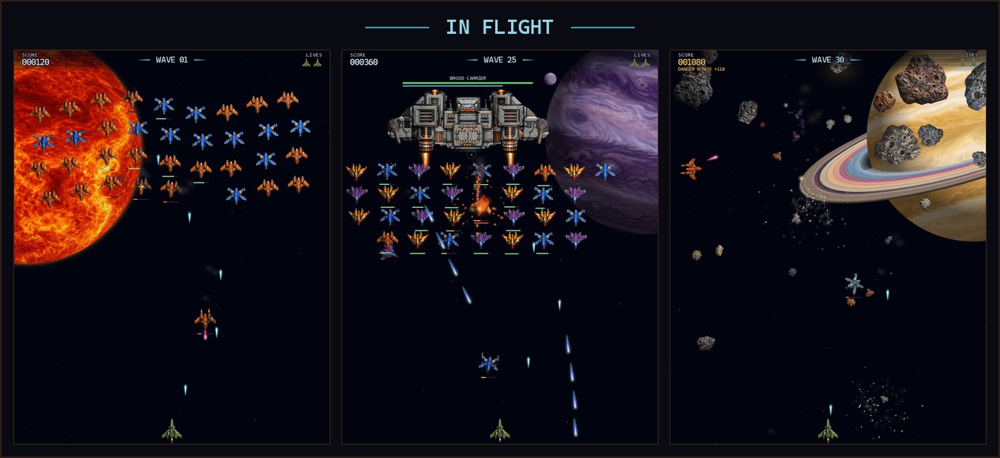
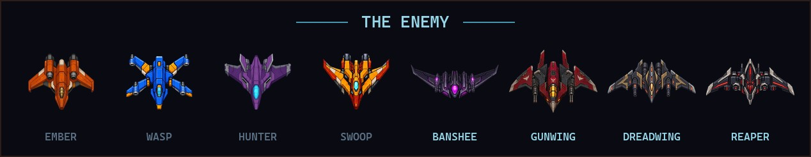

  

  

  <a href="https://github.com/RobG66/Cinderwing-Game/releases">All releases</a> &nbsp;·&nbsp; <a href="CHANGELOG.md">Changelog</a>

Cinderwing is an old-school formation shooter. Squadrons line up, then peel off and dive at you in groups. Hit a ship and it smokes, catches fire or spins out. Blow one up next to its wingmates and the blast can take them with it. Flying close is dangerous, but it scores more.

  

  

### What you're up against

- Three carriers: the Space Carrier, the Siege Ark and the Brood Carrier.
- Black holes that drag ships off course, nebulae that change how a fight plays, and asteroid fields with explosive rocks.
- Danger bonuses for flying close, and extra points when wrecks take out their neighbours.
- Three player ships, an extra ship every 50,000 points, and New Game+ tiers unlocked at waves 10, 20 and 30.

### Playing

Grab the package for your system from the [latest release](https://github.com/RobG66/Cinderwing-Game/releases/latest) under **Assets**. Nothing to install.

| | Package | To start |
| --- | --- | --- |
| **Windows** | `win-x64` .zip | Extract it and run `Cinderwing.exe` |
| **Linux** | `linux-x64` .tar.gz | Extract it and run `./Cinderwing` |

Move with **A / D** or the arrow keys, fire with **Space**, pause with **P** or **Esc**. Keyboard and controller can be remapped under **Options → Controls**. Fullscreen, windowed and a rotated portrait mode are in **Options** too. Settings and high scores are saved next to the game.

### Support

Cinderwing is free. If you'd like to chip in: [Ko-fi](https://ko-fi.com/robg66) · [PayPal](https://paypal.me/RGanshorn) · [GitHub Sponsors](https://github.com/sponsors/RobG66)
