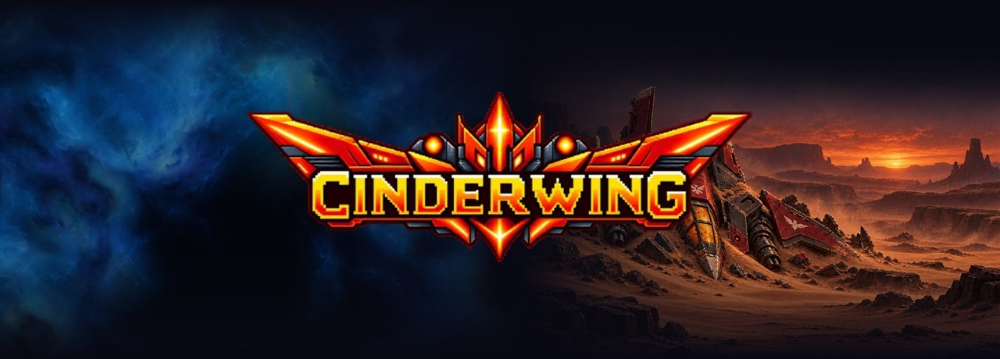
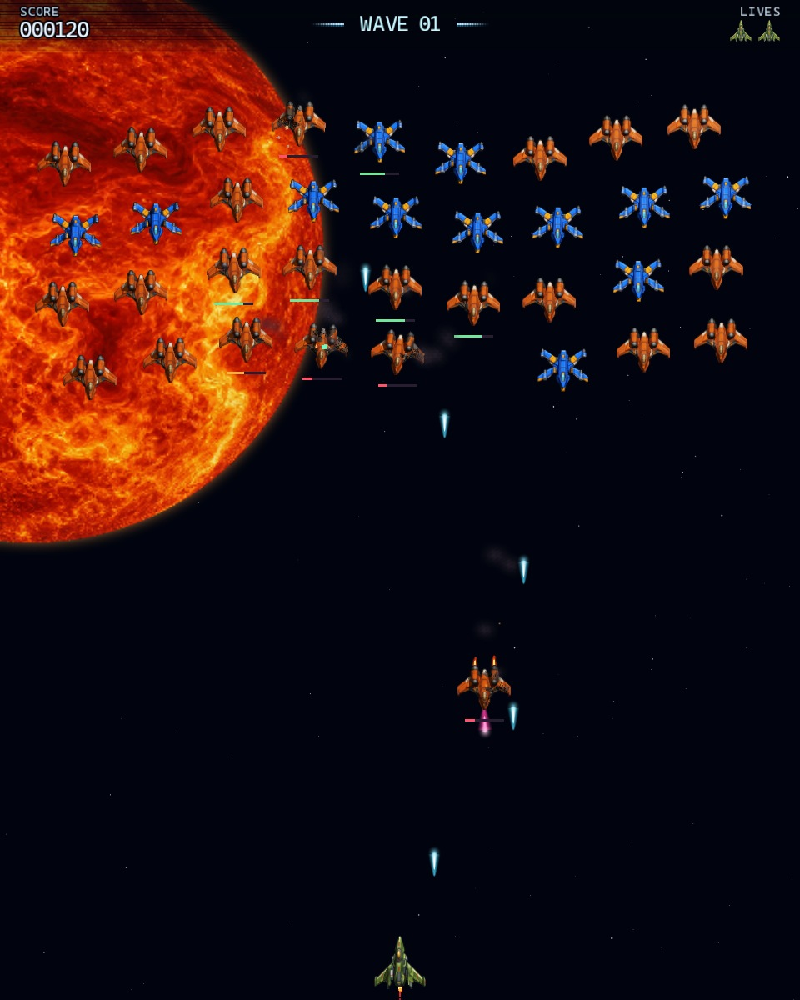
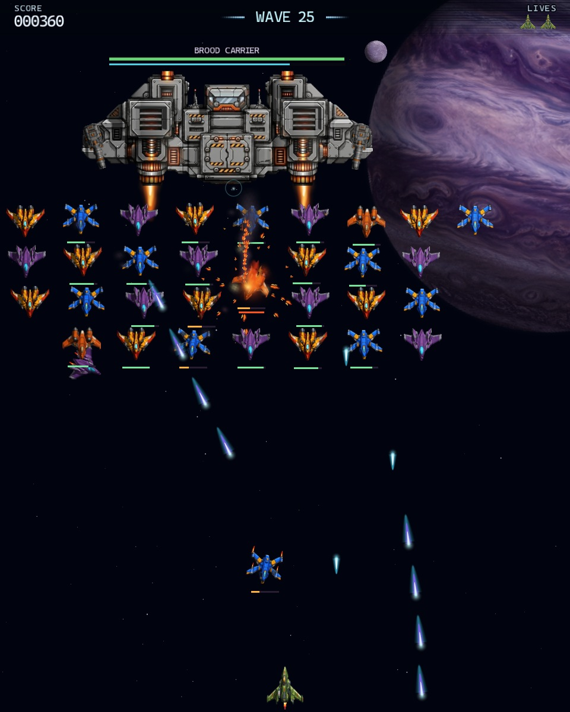
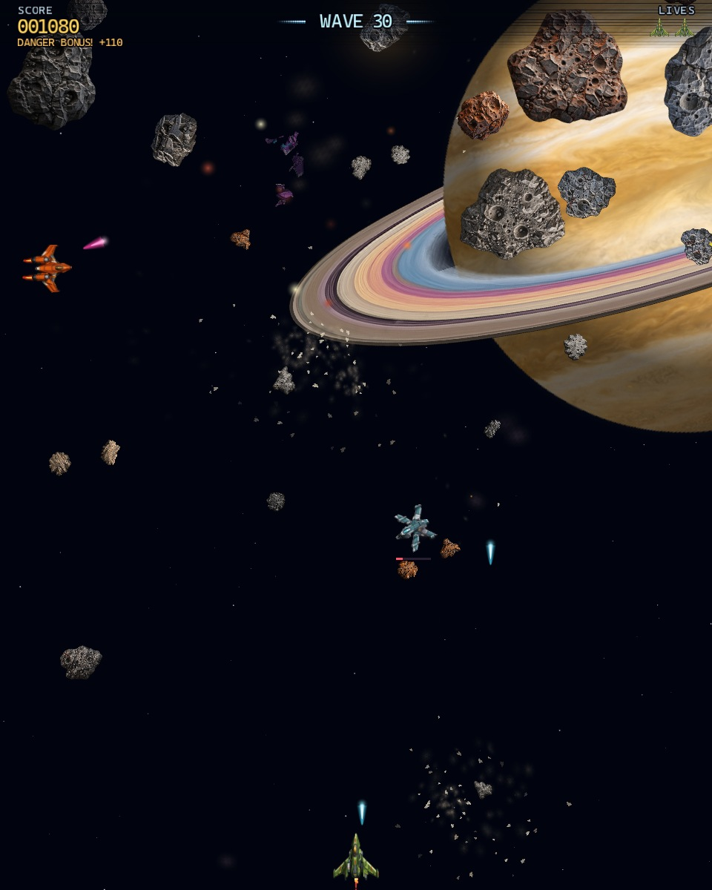

<picture>
  
</picture>

<h1 align="center">Cinderwing</h1>

A vertical arcade space shooter with diving squadrons, carrier battles, and asteroid fields that can turn a run around.

  

Windows x64 · Linux x64 <a href="https://github.com/RobG66/Cinderwing-Game/releases">All releases</a> · <a href="CHANGELOG.md">Changelog</a>

## In flight

  
  
  

## Features

- **Read the enemy.** Fighters break formation, dive in groups, and bank out of attack runs. Elite pilots and specialty ships bring their own patterns, from Reaper's capture attacks to Gunwing's gun runs.
- **Take on three carriers.** Battle the Space Carrier, Siege Ark, and Brood Carrier as you push into later star systems.
- **Use the hazards.** Black holes pull ships off course, nebulae change combat conditions, and explosive asteroids can set off chain reactions.
- **Chase a higher score.** Pick from three player ships, earn an extra ship every 50,000 points, and unlock three New Game+ tiers by clearing waves 10, 20, and 30.
- **Controls and display.** Remap keyboard and controller inputs, switch between windowed and fullscreen, or rotate the playfield 90° for a portrait monitor.

## Download and play

Open the [latest release](https://github.com/RobG66/Cinderwing-Game/releases/latest) and choose the package under **Assets**.

| Platform | Package | Start the game |
| --- | --- | --- |
| Windows x64 | `win-x64` ZIP | Extract the archive and open `Cinderwing.exe`. |
| Linux x64 | `linux-x64` TAR.GZ | Extract the archive, open a terminal in that folder, and run `./Cinderwing`. |

The packages are portable and include the game runtime. Settings and high scores are saved beside the executable. The keyboard defaults are **A / D** or **← / →** to move, **Space** to fire, and **P** or **Esc** to pause. Change bindings under **Options → Controls**.

## Support Cinderwing

If you enjoy the game and want to support future development, you can donate through [PayPal](https://paypal.me/RGanshorn), [Ko-fi](https://ko-fi.com/robg66), or [GitHub Sponsors](https://github.com/sponsors/RobG66).
